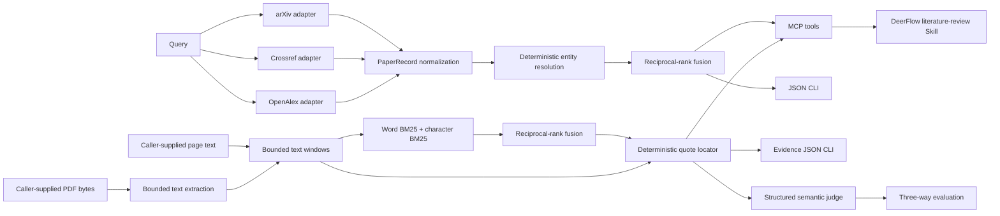

# ScholarFlow Academic Search MCP

`scholarflow-mcp` is an evidence-oriented scholarly research service for DeerFlow. It
combines deterministic multi-source metadata resolution, bounded page-text retrieval,
page-level quote location, and an optional model-based claim-evidence judge.

## Architecture



Provider adapters own remote schema parsing only. `dedup.py` owns identity decisions,
`service.py` owns concurrency and fusion, and `application.py` is the shared entry point
for the MCP server, command-line client, and live benchmark.

It deliberately does not ask an LLM to decide whether two records are the same paper.
The deduplication contract is inspectable and benchmarked offline:

1. Exact DOI, arXiv ID, or OpenAlex ID matches are strong identity links.
2. Version links without shared IDs require an informative title, compatible year,
   matching first-author surname, and sufficient author overlap.
3. Near-title matches additionally require token and sequence similarity thresholds.
4. Conflicting years, dates, venues, and titles are retained in `conflicts` instead of
   being overwritten silently.

## MCP tools

- `search_literature`: query selected providers and return normalized, deduplicated
  records plus provider-level status diagnostics.
- `normalize_papers`: deduplicate caller-supplied metadata without network access.
- `verify_evidence_spans`: locate quoted text on caller-supplied document pages and
  return exact character offsets. It deliberately reports semantic support as
  `not_assessed`.
- `retrieve_claim_evidence`: find candidate quotes for claims in caller-supplied
  pages using word and character BM25 rank fusion. Results preserve document IDs,
  page numbers, original character offsets, channel ranks, and retrieval scores.
  The `word_bm25` mode is a reproducible ablation baseline.
- `extract_pdf_pages`: extract embedded text from bounded caller-supplied Base64 PDF
  bytes. It does not fetch URLs, perform OCR, or reconstruct layout.
- `assess_claim_evidence`: locate declared quotes first, then ask a configured model
  judge for `supported`, `contradicted`, or `insufficient`; every non-insufficient
  verdict must cite a supplied span ID.
- `assess_retrieved_claim_evidence`: retrieve candidate quotes, locate them again
  against the supplied pages, then call the same bounded model judge. Claims with
  no lexical candidate become `insufficient` without a model call.

Provider-local ranks are combined with reciprocal-rank fusion after deduplication, so
`max_results` is a global output limit rather than a per-provider truncation. Each
record exposes `fused_relevance_score` and the original rank of every source record.
Each response reports `total_raw_records`, `unique_before_limit`, `unique_records`,
and `duplicates_removed`. A provider timeout or API failure does not erase successful
results from the other providers; its typed error is returned in `provider_status`.

## Run locally

From the repository root, run a human-readable demo without configuring DeerFlow:

```bash
uv run --project backend/packages/scholarflow-mcp scholarflow-search \
  "GNSS spoofing UAV navigation" --max-results 5
```

The command writes normalized JSON to stdout. Use `--output result.json` for an
artifact, `--providers arxiv crossref` to restrict coverage, and year flags when the
scope requires them. It exits with code `2` only when every selected provider fails.

The repository also exposes `make scholarflow-demo QUERY="..."`.

To run offline evidence retrieval on page text without model credentials:

```bash
uv run --project backend/packages/scholarflow-mcp \
  scholarflow-retrieve-evidence \
  backend/packages/scholarflow-mcp/examples/retrieval_input.json
```

Add `--assess` to run the configured semantic judge after retrieval and exact quote
location. The input is a JSON object with `pages` (`document_id`, `page_number`,
`text`) and `claims` (`claim_id`, `text`). The local CLI reads the input artifact;
the MCP tools accept caller-supplied page data and never follow model-provided paths
or URLs. Retrieval uses bounded windows and deterministic tie-breaking. It returns
candidate text, not proof of claim support. A no-overlap query returns no candidates.

To verify page-level quote coordinates from a JSON artifact:

```bash
uv run --project backend/packages/scholarflow-mcp \
  scholarflow-verify-evidence \
  backend/packages/scholarflow-mcp/examples/evidence_input.json
```

The input contains `pages` (`document_id`, `page_number`, `text`) and `claims` with
declared evidence quotes. Matching is deterministic after Unicode, case, and whitespace
normalization; successful results preserve offsets into the original page text. The
command exits with code `1` when any supplied span cannot be located. It never fetches
paths or URLs, so PDF acquisition and page-text extraction remain the caller's
responsibility.

Extract embedded text from a local PDF through the CLI:

```bash
uv run --project backend/packages/scholarflow-mcp \
  scholarflow-extract-pdf paper.pdf --document-id paper-1 --output pages.json
```

The parser accepts at most 20 MB and 200 pages, extracts 50 pages by default, hashes the
source bytes, and reports empty pages. Empty pages may be scanned images; OCR is not
performed. The MCP variant accepts Base64 bytes instead of a path so model-provided
arguments cannot make the server read arbitrary local files.

To run the optional semantic judge over page-located quotes:

```bash
uv run --project backend/packages/scholarflow-mcp \
  scholarflow-assess-claims \
  backend/packages/scholarflow-mcp/examples/claim_assessment_input.json
```

This requires judge credentials and a model name. Unlocated quotes become
`insufficient` without a model call. Located quotes are sent as untrusted data using a
strict JSON Schema; returned claim IDs, labels, confidence values, and cited span IDs
are validated before they are accepted.

To start the stdio MCP server from `backend/`:

```bash
uv run --project packages/scholarflow-mcp scholarflow-mcp
```

Recommended environment variables:

```bash
SCHOLARFLOW_CONTACT_EMAIL=researcher@example.com
SCHOLARFLOW_OPENALEX_API_KEY=optional-openalex-key
SCHOLARFLOW_HTTP_TIMEOUT_SECONDS=20
SCHOLARFLOW_JUDGE_API_KEY=required-only-for-semantic-assessment
SCHOLARFLOW_JUDGE_MODEL=operator-selected-model
SCHOLARFLOW_JUDGE_ENDPOINT=https://api.openai.com/v1/responses
SCHOLARFLOW_JUDGE_TIMEOUT_SECONDS=60
```

`SCHOLARFLOW_CONTACT_EMAIL` opts Crossref requests into its polite pool. OpenAlex can
be tried without a key, but production use should provide one according to its current
API policy.

To register the stdio server in DeerFlow, copy the disabled `scholarflow-academic`
entry from the repository's `extensions_config.example.json` into
`extensions_config.json` and set `enabled` to `true`. The example assumes the Gateway
starts from `backend/`; adjust `PYTHONPATH` when using another working directory. The
retrieval credential variables are optional and resolve to empty values when unset.
Judge configuration is read only when semantic assessment is requested, so metadata,
PDF extraction, and deterministic quote location stay usable without a model key.

## Verification

Run unit tests and lint from the repository root:

```bash
uv run --project backend/packages/scholarflow-mcp --extra dev pytest -q
uv run --project backend/packages/scholarflow-mcp --extra dev ruff check .
uv run --project backend/packages/scholarflow-mcp --extra dev ruff format --check .
```

`make scholarflow-check` runs lint, formatting, tests, the synthetic regression gate,
and package build. The dedicated `.github/workflows/scholarflow-mcp.yml` workflow runs
the same offline checks for relevant pull requests.

Run the committed synthetic deduplication benchmark:

```bash
uv run --project backend/packages/scholarflow-mcp scholarflow-dedup-benchmark
```

The fixture is intentionally synthetic and contains no copied paper abstracts. The
benchmark reports pairwise precision, recall, and F1, making future heuristic changes
reviewable instead of anecdotal.

### Live known-item benchmark

```bash
uv run --project backend/packages/scholarflow-mcp \
  scholarflow-known-item-benchmark --max-results 10 \
  --output known-item-result.json
```

This manual benchmark asks whether a committed set of known papers appears within
Top-K and reports HitRate@K, MRR@K, provider availability, cross-source deduplication
rate, and P50/P95 latency. It is deliberately excluded from CI because public APIs and
network latency are external state.

**Metric boundary:** known-item HitRate is not recall. A real Recall@K or nDCG claim
requires a human-labeled relevance pool for every query. The suite hashes itself into
the output so saved baselines remain attributable to an exact case set. See the
[committed manual baseline](benchmarks/BASELINE.md) for the current measurement and its
limitations.

### Human-annotated semantic benchmark

ScholarFlow does not bundle or silently download third-party scientific text. Download
SciFact from its [maintainer repository](https://github.com/allenai/scifact), then
convert a labeled split locally:

```bash
uv run --project backend/packages/scholarflow-mcp scholarflow-import-scifact \
  --corpus data/corpus.jsonl --claims data/claims_dev.jsonl \
  --output scifact-dev-cases.json

uv run --project backend/packages/scholarflow-mcp scholarflow-claim-benchmark \
  scifact-dev-cases.json --output scifact-dev-result.json
```

The adapter preserves SciFact's human labels and gold rationale sentence IDs. Its
metric is oracle-evidence three-way classification macro-F1: retrieval, PDF extraction,
and open-domain scientific correctness are outside that score. The run is manual and
networked because it invokes the configured model judge. See
[the benchmark protocol](benchmarks/SCIFACT.md).

### Cited-document evidence retrieval benchmark

The offline [retrieval protocol and paired development-set measurement](benchmarks/RETRIEVAL.md)
compare word BM25 against word plus character BM25 with rank fusion on the same
user-downloaded SciFact development data. This measures whether annotated evidence
sentences appear in Top-K windows **within known cited abstracts**; it is not an
open-corpus retrieval, answer quality, or PDF extraction score.

## Current boundary

This release candidate extracts embedded PDF text, retrieves candidate evidence
windows from caller-supplied pages, and can produce model-based semantic labels over
re-located quotes. It does not perform OCR, recover document layout, retrieve full
text from the web, or establish scientific truth. Its lexical retriever can miss
paraphrases. Semantic labels are judge outputs with explicit model/request provenance.
