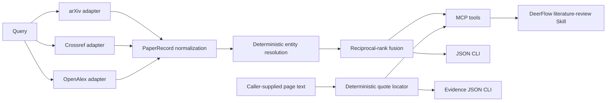

# ScholarFlow Academic Search MCP

`scholarflow-mcp` is a deterministic, evidence-oriented scholarly metadata service for
DeerFlow. It queries arXiv, Crossref, and OpenAlex concurrently, normalizes their
incompatible schemas, merges duplicate preprint/published records, and preserves the
source and conflict history behind every merged field.

## Architecture



Provider adapters own remote schema parsing only. `dedup.py` owns identity decisions,
`service.py` owns concurrency and fusion, and `application.py` is the shared entry point
for the MCP server, command-line client, and live benchmark.

It deliberately does not ask an LLM to decide whether two records are the same paper.
The deduplication contract is inspectable and benchmarked offline:

1. Exact DOI, arXiv ID, or OpenAlex ID matches are strong identity links.
2. Version links without shared IDs require an informative title, compatible year,
   matching first-author surname, and sufficient author overlap.
3. Near-title matches additionally require token and sequence similarity thresholds.
4. Conflicting years, dates, venues, and titles are retained in `conflicts` instead of
   being overwritten silently.

## MCP tools

- `search_literature`: query selected providers and return normalized, deduplicated
  records plus provider-level status diagnostics.
- `normalize_papers`: deduplicate caller-supplied metadata without network access.
- `verify_evidence_spans`: locate quoted text on caller-supplied document pages and
  return exact character offsets. It deliberately reports semantic support as
  `not_assessed`.

Provider-local ranks are combined with reciprocal-rank fusion after deduplication, so
`max_results` is a global output limit rather than a per-provider truncation. Each
record exposes `fused_relevance_score` and the original rank of every source record.
Each response reports `total_raw_records`, `unique_before_limit`, `unique_records`,
and `duplicates_removed`. A provider timeout or API failure does not erase successful
results from the other providers; its typed error is returned in `provider_status`.

## Run locally

From the repository root, run a human-readable demo without configuring DeerFlow:

```bash
uv run --project backend/packages/scholarflow-mcp scholarflow-search \
  "GNSS spoofing UAV navigation" --max-results 5
```

The command writes normalized JSON to stdout. Use `--output result.json` for an
artifact, `--providers arxiv crossref` to restrict coverage, and year flags when the
scope requires them. It exits with code `2` only when every selected provider fails.

The repository also exposes `make scholarflow-demo QUERY="..."`.

To verify page-level quote coordinates from a JSON artifact:

```bash
uv run --project backend/packages/scholarflow-mcp \
  scholarflow-verify-evidence \
  backend/packages/scholarflow-mcp/examples/evidence_input.json
```

The input contains `pages` (`document_id`, `page_number`, `text`) and `claims` with
declared evidence quotes. Matching is deterministic after Unicode, case, and whitespace
normalization; successful results preserve offsets into the original page text. The
command exits with code `1` when any supplied span cannot be located. It never fetches
paths or URLs, so PDF acquisition and page-text extraction remain the caller's
responsibility.

To start the stdio MCP server from `backend/`:

```bash
uv run --project packages/scholarflow-mcp scholarflow-mcp
```

Recommended environment variables:

```bash
SCHOLARFLOW_CONTACT_EMAIL=researcher@example.com
SCHOLARFLOW_OPENALEX_API_KEY=optional-openalex-key
SCHOLARFLOW_HTTP_TIMEOUT_SECONDS=20
```

`SCHOLARFLOW_CONTACT_EMAIL` opts Crossref requests into its polite pool. OpenAlex can
be tried without a key, but production use should provide one according to its current
API policy.

To register the stdio server in DeerFlow, copy the disabled `scholarflow-academic`
entry from the repository's `extensions_config.example.json` into
`extensions_config.json` and set `enabled` to `true`. The example assumes the Gateway
starts from `backend/`; adjust `PYTHONPATH` when using another working directory. The
two credential-related environment variables are optional and resolve to empty values
when unset.

## Verification

Run unit tests and lint from the repository root:

```bash
uv run --project backend/packages/scholarflow-mcp --extra dev pytest -q
uv run --project backend/packages/scholarflow-mcp --extra dev ruff check .
uv run --project backend/packages/scholarflow-mcp --extra dev ruff format --check .
```

`make scholarflow-check` runs lint, formatting, tests, the synthetic regression gate,
and package build. The dedicated `.github/workflows/scholarflow-mcp.yml` workflow runs
the same offline checks for relevant pull requests.

Run the committed synthetic deduplication benchmark:

```bash
uv run --project backend/packages/scholarflow-mcp scholarflow-dedup-benchmark
```

The fixture is intentionally synthetic and contains no copied paper abstracts. The
benchmark reports pairwise precision, recall, and F1, making future heuristic changes
reviewable instead of anecdotal.

### Live known-item benchmark

```bash
uv run --project backend/packages/scholarflow-mcp \
  scholarflow-known-item-benchmark --max-results 10 \
  --output known-item-result.json
```

This manual benchmark asks whether a committed set of known papers appears within
Top-K and reports HitRate@K, MRR@K, provider availability, cross-source deduplication
rate, and P50/P95 latency. It is deliberately excluded from CI because public APIs and
network latency are external state.

**Metric boundary:** known-item HitRate is not recall. A real Recall@K or nDCG claim
requires a human-labeled relevance pool for every query. The suite hashes itself into
the output so saved baselines remain attributable to an exact case set. See the
[committed manual baseline](benchmarks/BASELINE.md) for the current measurement and its
limitations.

## Current boundary

This release candidate validates metadata retrieval, entity resolution, and whether a
declared quote exists on a supplied page. It does not parse PDFs, infer page numbers,
perform fuzzy quotation recovery, or judge whether the located text semantically
supports a generated claim. Those semantic and document-ingestion capabilities remain
separate future work.
